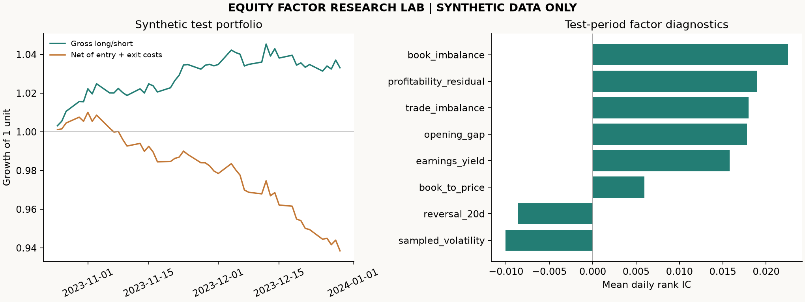

# Equity Factor Research Lab

**From exploratory equity signals to a reproducible research workflow.**

[Research roadmap](https://github.com/users/Zz8260/projects/2) · [Methodology](docs/METHODOLOGY.md) · [Validation record](docs/VALIDATION.md) · [Automated checks](https://github.com/Zz8260/equity-factor-research-lab/actions)

A standalone Python portfolio project covering equity factor engineering, industry and size exposure removal, chronological model selection, and cost-aware portfolio diagnostics. Its research themes are grounded in a locally reviewed archive of **77 Python research scripts**.

> **Evidence boundary:** all figures and metrics in this repository use generated synthetic data. The archive contains code, not verifiable performance reports. This project makes no claim about historical investment returns, deployed strategies, employer outcomes, or a count of independently validated factors.



## Project at a glance

| Item | Scope |
| --- | --- |
| Research domain | Equity valuation, reversal, intraday activity and market microstructure |
| Runnable implementation | Eight representative signals, date-local processing, Ridge selection and an intraday portfolio abstraction |
| Default experiment | 260 business dates, 60 fictional securities, 12 intraday samples per security per day |
| Evaluation | Chronological 60% / 20% / 20% split with boundary-label purging |
| Engineering | Installable package, command-line entry point, regression tests and GitHub Actions |
| Outputs | Self-contained HTML report, chart, CSV diagnostics and JSON experiment record |
| Original archive | Reviewed locally; credentials, private adapters and original source files are excluded |

## Why this project exists

Exploratory research often grows into many platform-specific scripts. A reviewer needs to see the hypothesis, data timing, transformation, validation and limitations in one coherent workflow. This repository reconstructs that workflow using ordinary Python libraries and fictional observations so it can be run without access to an internal research platform.

The archive shows research across valuation, profitability, turnover-weighted reversal, intraday return distributions, trade imbalance, order-book depth, cancellation behavior, nonlinear price adjustments, regression and decision trees. The executable demonstration implements a representative subset. [Provenance](docs/PROVENANCE.md) explains the distinction between the archive and this new implementation.

## Run in a few minutes

Requires Python 3.10 or later. Run these commands from a terminal:

```bash
git clone https://github.com/Zz8260/equity-factor-research-lab.git
cd equity-factor-research-lab
python -m venv .venv
source .venv/bin/activate
# Windows PowerShell: .venv\Scripts\Activate.ps1
python -m pip install -e ".[dev]"
factorlab demo
python -m pytest -q
```

Open `reports/demo_report.html` in a browser. No API keys, paid data feeds or network access are required after dependencies are installed. The demo overwrites generated files in the selected output directory.

```bash
# Run an alternative experiment into a separate directory.
factorlab demo --seed 7 --days 180 --symbols 40 --cost-bps 5 --output /tmp/factorlab-demo
```

## Research workflow

```mermaid
flowchart LR
    A[Synthetic daily and intraday panels] --> B[Validate keys and numeric fields]
    B --> C[Construct eight daily signals]
    C --> D[Winsorize and residualize each date]
    D --> E[Rank features within each date]
    E --> F[Attach next-session open-to-close labels]
    F --> G[Chronological train / validation / test]
    G --> H[Select Ridge alpha on validation IC]
    H --> I[Untouched test predictions]
    I --> J[Costs, diagnostics and report]
```



Signals are formed after the close of day **t**, using information available by then. The label is the open-to-close return of the next market session **t+1**. All symbols from a given date stay in the same partition; observations whose labels cross partition boundaries are removed from training or validation.

## Implemented signals

| Signal | Definition | Research theme |
| --- | --- | --- |
| Earnings yield | Earnings / market capitalization | Valuation |
| Book to price | Book equity / market capitalization | Valuation |
| Profitability residual | Cross-sectional ROE residual after regression on earnings yield | Profitability versus valuation |
| 20-day reversal | Negative turnover-weighted mean close-to-close return | Price reversal |
| Sampled volatility | Square root of sum of squared sampled intraday returns | Intraday risk |
| Trade imbalance | (Buy volume - sell volume) / total classified volume | Trade flow |
| Book imbalance | Mean normalized bid/ask depth imbalance | Order-book activity |
| Opening gap | Today's open / previous session's close - 1 | Overnight price movement |

These are simplified reconstructed definitions. The profitability residual uses a daily cross-section; the original archive also explores per-security time-series regressions. Sampled volatility uses 12 observations rather than complete minute bars. [Factor details](docs/FACTOR_CATALOG.md) documents these differences.

## What to inspect

| File or folder | Review purpose |
| --- | --- |
| [Methodology](docs/METHODOLOGY.md) | Timing, preprocessing, labels, model selection, costs and limitations |
| [Data contract](docs/DATA_CONTRACT.md) | Input fields and requirements for adapting the functions |
| [Source inventory](docs/source_inventory.csv) | English index of 77 reviewed research scripts |
| [Portfolio case study](docs/CASE_STUDY.md) | Problem, scope, deliverables and honest presentation language |
| [Reviewer walkthrough](docs/REVIEWER_GUIDE.md) | A five-minute demonstration and interview prompts |
| [Roadmap](docs/ROADMAP.md) | Completed demonstration scope and explicit next steps |
| [Generated summary](reports/summary.json) | Reproduction settings, versions, split dates and metrics |
| [Source package](src/factorlab) | Data, factors, evaluation, report and CLI modules |
| [Tests](tests/test_research.py) | Future-data invariance, label alignment, partition isolation and costs |

## Interpreting results

The report presents daily rank IC, gross and cost-adjusted portfolio curves, turnover, volatility, drawdown and a zero-risk-free-rate Sharpe estimate. A negative cost-adjusted result is retained as generated. Synthetic latent structure was intentionally included in the simulator; a favorable metric would not establish predictive ability on real markets.

The portfolio is a research abstraction: it enters at the next open and closes to cash at the next close, with 50% long and 50% short exposure. Costs apply to both legs of every round trip. Borrow, financing, price limits, execution queues and capacity are omitted. A-share T+1 and short-sale restrictions can make this implementation infeasible in production. See the [methodology](docs/METHODOLOGY.md) before drawing conclusions.

## Attribution and usage

Maintained for the portfolio of [Zz8260](https://github.com/Zz8260). Documentation and the standalone implementation were prepared with AI assistance from the supplied research archive. Original archive ownership and individual contribution were not independently verified. No employer endorsement or redistribution right is implied. No open-source license is granted at this stage; see [usage notes](USAGE_NOTICE.md).
